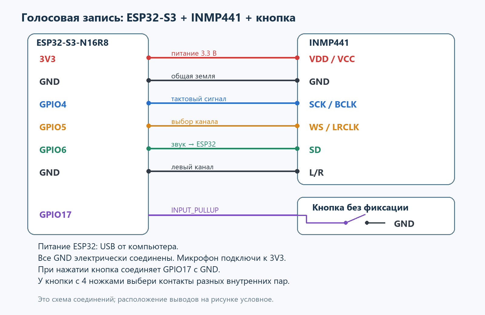

# Запись и передача звука

ESP32-S3-N16R8 + INMP441. Удержание кнопки записывает звук, отпускание отправляет
WAV на POST /voice. Формат: PCM16, mono, 16 кГц. Сервер сохраняет файл;
распознавания речи в этой версии нет.

## Подключение

Подключать при отключённом питании. Ориентироваться на подписи контактов.

| INMP441 | ESP32-S3 |
| --- | --- |
| VDD / VCC | 3V3 |
| GND | GND |
| SCK / BCLK | GPIO4 |
| WS / LRCLK | GPIO5 |
| SD | GPIO6 |
| L/R | GND (левый канал) |

Кнопка: GPIO17 — кнопка — GND. Используется INPUT_PULLUP, нажатие = LOW.
У четырёхножечной кнопки выбрать пару, замыкающуюся только при нажатии.
LED отключён (LED_PIN = -1).

## Прошивка

1. Открыть micro/micro.ino в Arduino IDE. Рядом оставить audio_format.h.
2. Установить пакет плат Espressif ESP32; исходная сборка проверялась на 3.3.12.
3. Выбрать ESP32S3 Dev Module, Flash 16MB, PSRAM OPI PSRAM для N16R8,
   Partition Scheme: 16M Flash (3MB APP/9.9MB FATFS).
4. Скопировать micro/secrets.example.h в micro/secrets.h.
   Вписать SSID, пароль и LAN-адрес компьютера с сервером, сохранив /voice.
   Без локального файла скетч собирается с настройками-заглушками.
5. Выбрать COM-порт. Для USB-UART: USB CDC On Boot Disabled;
   для встроенного USB: Enabled, USB Mode Hardware CDC and JTAG.
6. Загрузить скетч, открыть Serial Monitor 115200.

При доступной PSRAM буфер рассчитан на 30 с. Без PSRAM выделяется буфер на
4, 3 или 2 с; реальный лимит выводится в Serial. После заполнения буфера новые
отсчёты пропускаются до отпускания кнопки. Антидребезг — 30 мс.

## Сервер

Из корня репозитория, в PowerShell:

    py -m pip install -r tests/micro/server/requirements.txt
    & ./tests/micro/server/start_server.ps1

Проверка: открыть http://127.0.0.1:8000/health. Остановка: Ctrl+C.
ESP32 и компьютер должны быть в доступной друг другу локальной сети.
WAV сохраняются в tests/micro/server/recordings; tasks.db создаётся рядом с main.py.
JSON-режим POST /voice и GET /tasks сохранены для раннего прототипа задач.
WAV сам по себе задачу не создаёт.

Зажать кнопку, произнести фразу и отпустить. Ожидаются HTTP: 200 и новый WAV.
Записи короче 0,2 с пропускаются. При ошибке отправки файл остаётся в RAM:
команда r в Serial повторяет передачу. Новая запись заменяет предыдущую;
перезапуск очищает RAM. Повтор после потери ответа может создать второй файл.
Во время HTTP-передачи новая запись не начинается.

Нулевой пик: проверить питание, SD и L/R. Клиппинг: уменьшить MIC_GAIN до 2 или 1.
Нет HTTP: проверить LAN-адрес, Wi-Fi, изоляцию клиентов и доступ к порту 8000.

## Проверки без платы

Нужны Python с зависимостями сервера и g++ в PATH:

    & ./tests/micro/checks/run_checks.ps1

C++-тест проверяет PCM, насыщение и формирует WAV кодом из прошивки.
Четыре HTTP-теста запускают отдельный Uvicorn на свободном локальном порту:
проверяют WAV из C++, длительность, ошибочные запросы, JSON и SQLite.
Временные базы и записи создаются в .build; рабочая база не используется.

## Результат этапа

В октябре прошли сборка N16R8, C++-проверка и четыре HTTP-теста.
Подключение платы к Wi-Fi наблюдалось; при выключенной PSRAM лимит был около 4 с.
Успешная запись с INMP441, отправка с платы и прослушивание результата
пока не зафиксированы. Следующая аппаратная проверка — OPI PSRAM и полный путь до WAV.
